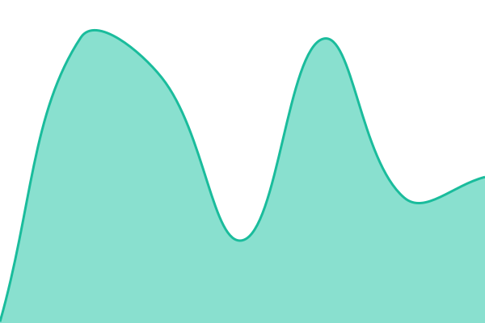

# [📈 Live Status](https://status.kashfy.site): <!--live status--> **🟧 Partial outage**

This repository contains the open-source uptime monitor and status page for [https://github.com/kashfy-clinic](https://status.kashfy.site), powered by [Upptime](https://github.com/upptime/upptime).

With [Upptime](https://upptime.js.org), you can get your own unlimited and free uptime monitor and status page, powered entirely by a GitHub repository. We use [Issues](https://github.com/https://github.com/kashfy-clinic/status/issues) as incident reports, [Actions](https://github.com/https://github.com/kashfy-clinic/status/actions) as uptime monitors, and [Pages](https://status.kashfy.site) for the status page.

<!--start: status pages-->
<!-- This summary is generated by Upptime (https://github.com/upptime/upptime) -->
<!-- Do not edit this manually, your changes will be overwritten -->
<!-- prettier-ignore -->
| URL | Status | History | Response Time | Uptime |
| --- | ------ | ------- | ------------- | ------ |
|  [Website](https://docistra.com) | 🟩 Up | [website.yml](https://github.com/docistra/docistra-status/commits/HEAD/history/website.yml) | 

 398ms
     
 | 

<a href="https://status.docistra.com/history/website">99.07%</a>
    

|  [Health](https://docistra.com/api/health) | 🟥 Down | [health.yml](https://github.com/docistra/docistra-status/commits/HEAD/history/health.yml) | 

 721ms
     
 | 

<a href="https://status.docistra.com/history/health">99.07%</a>
    

|  [App](https://app.docistra.com/api/health/live) | 🟩 Up | [app.yml](https://github.com/docistra/docistra-status/commits/HEAD/history/app.yml) | 

 153ms
     
 | 

<a href="https://status.docistra.com/history/app">99.07%</a>
    

|  [Automations API](https://api.docistra.com/healthz) | 🟩 Up | [automations-api.yml](https://github.com/docistra/docistra-status/commits/HEAD/history/automations-api.yml) | 

 146ms
     
 | 

<a href="https://status.docistra.com/history/automations-api">100.00%</a>
    

|  [SMS Gateway](https://sms.docistra.com/api/v1/auth/who-am-i) | 🟩 Up | [sms-gateway.yml](https://github.com/docistra/docistra-status/commits/HEAD/history/sms-gateway.yml) | 

 157ms
     
 | 

<a href="https://status.docistra.com/history/sms-gateway">100.00%</a>
    

|  [Help Center](https://help.docistra.com/healthz) | 🟩 Up | [help-center.yml](https://github.com/docistra/docistra-status/commits/HEAD/history/help-center.yml) | 

 148ms
     
 | 

<a href="https://status.docistra.com/history/help-center">65.54%</a>
    

<!--end: status pages-->

[**Visit our status website →**](https://status.kashfy.site)

## 📄 License

- Powered by: [Upptime](https://github.com/upptime/upptime)
- Code: [MIT](./LICENSE) © [Anand Chowdhary](https://anandchowdhary.com)
- Data in the `./history` directory: [Open Database License](https://opendatacommons.org/licenses/odbl/1-0/)
